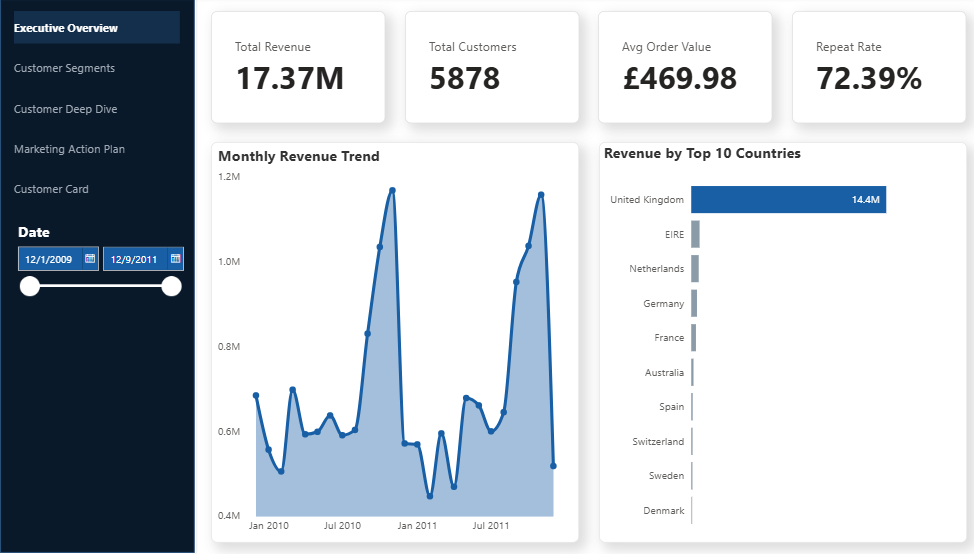
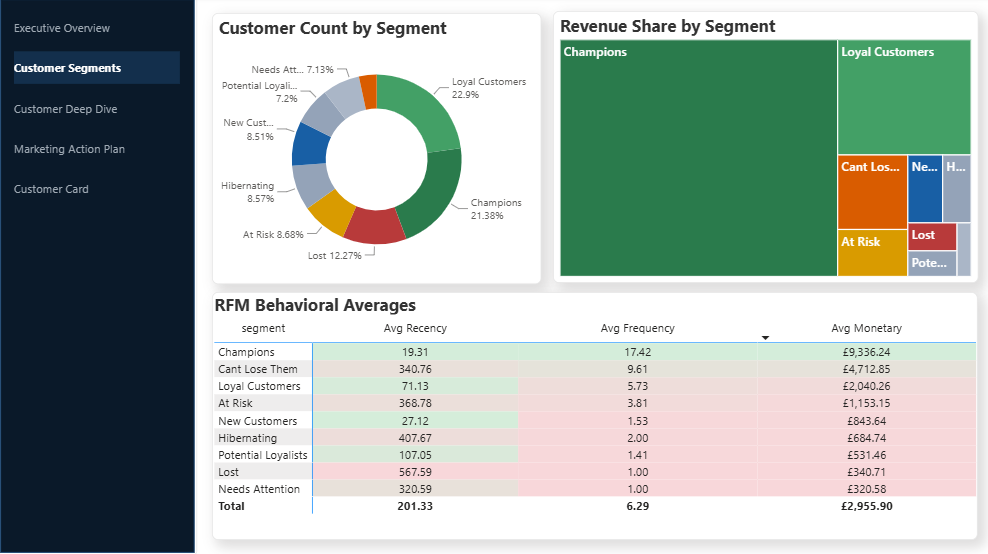
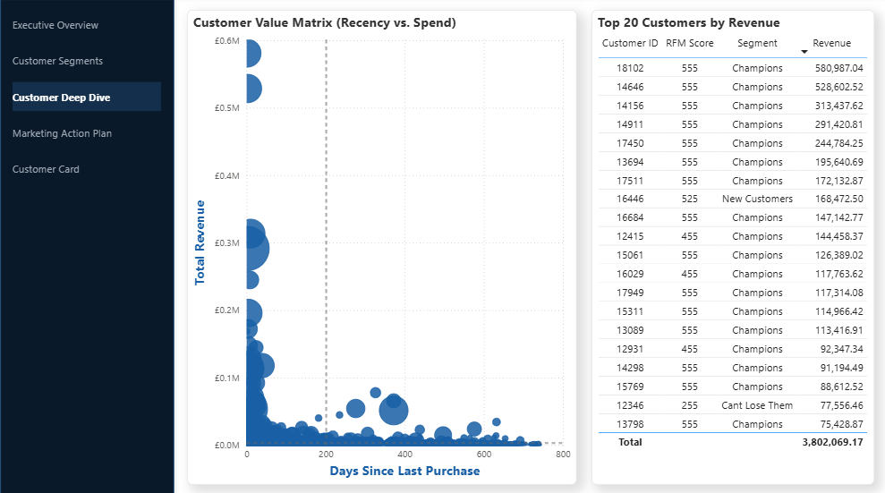
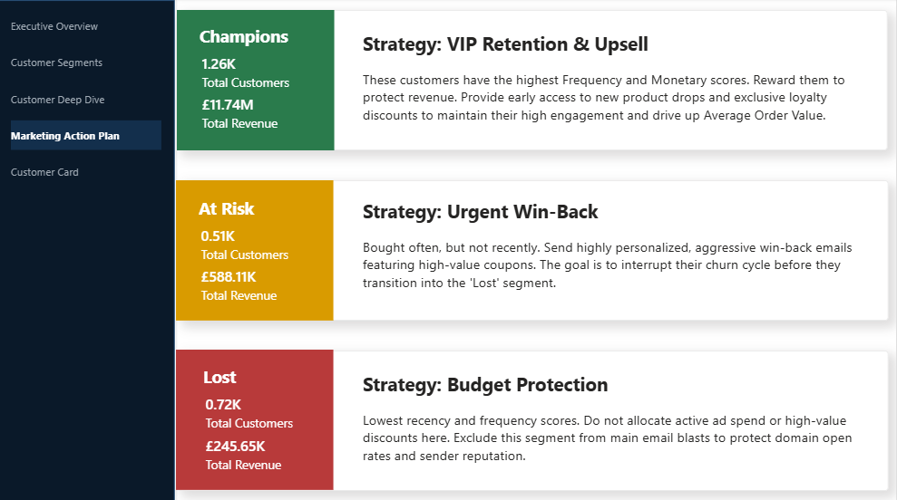
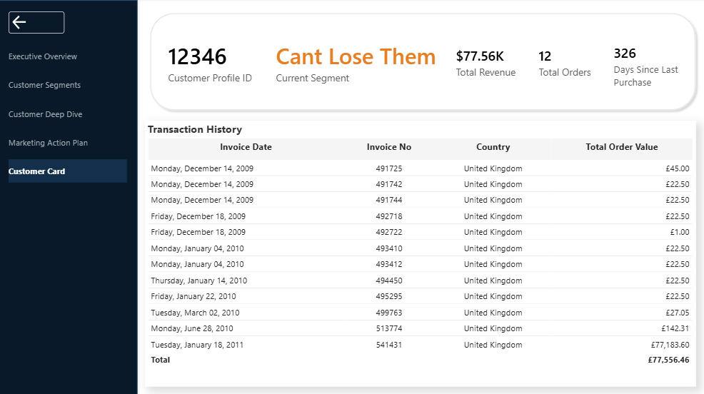

# E-commerce Customer Intelligence (RFM Analysis)

**PostgreSQL | Power BI | DAX** - a portfolio case study on public data (UCI Online Retail II)

Which customers is an online retailer about to lose, and how much are they worth? I cleaned 1M+ raw transaction rows in PostgreSQL, grouped 5,878 customers into 9 RFM segments and built a 5-page Power BI dashboard with a marketing action plan.

**Headline results:** Champions (21% of customers) generated 68% of £17.4M revenue, 72% of customers ordered more than once, and 510 at-risk customers had spent £588K.

> **v2 update (October 2026):** I fixed a duplicate-removal bug that deleted real sales lines and understated revenue by 26%. Every number on this page is a corrected v2 result. See the [Changelog](#changelog).

## Project walkthrough video

The video was recorded with the v1 numbers (before the fix). The method and dashboard design are the same, and the corrected numbers are on this page.

## Business question
An online retailer sends the same marketing to every customer. Which customers are the most valuable, which are slipping away, and where should marketing effort go?

## Dataset
- **Source:** [UCI Machine Learning Repository: Online Retail II](https://archive.ics.uci.edu/dataset/502/online+retail+ii) (downloaded via Kaggle)
- **Contents:** all transactions of a UK-based online retailer from 1 Dec 2009 to 9 Dec 2011
- **Size:** 1,067,371 raw rows (both yearly sheets combined). Prices are in pounds sterling (£).
- This is public data, used for a portfolio case study rather than for a real company.

## Approach
| Step | File | What it does |
|---|---|---|
| 1. Staging | `sql/01_create_tables.sql` | Creates `online_retail_raw`. Import the CSV once. |
| 2. Cleaning | `sql/02_data_cleaning.sql` | Keeps valid sales only and removes exact duplicates, creating `transactions_clean` |
| 3. RFM | `sql/03_rfm_calculation.sql` | Calculates Recency, Frequency and Monetary values with CTEs and scores each from 1 to 5 with `PERCENT_RANK` |
| 4. Segments | `sql/04_segmentation.sql` | Maps the scores to 9 segments with `CASE` rules |
| 5. Validation | `sql/05_validation_checks.sql` | Returns one results grid: row counts, revenue, segments and 3 checks |
| 6. Dashboard | `powerbi/ecommerce-rfm-analysis.pbix` | 5 Power BI pages with DAX measures and a drill-through customer card |

### Cleaning rules
| Rule | Reason |
|---|---|
| Remove rows without a customer ID | Guest checkouts can't be segmented |
| Remove rows with quantity of 0 or less | Returns |
| Remove rows with unit price of 0 or less | Free items and adjustments |
| Remove invoices starting with "C" | Cancelled orders |
| Remove exact duplicates (rows identical in every column) | Rows logged twice. 1-9 Dec 2010 also appears in both yearly sheets of the source file. |

### RFM definitions
- **Recency:** days since the customer's last purchase (reference date = 1 day after the last transaction)
- **Frequency:** number of distinct invoices
- **Monetary:** total spend (quantity x unit price)
- **Scores:** 1 to 5 by percentile rank (`PERCENT_RANK`), so customers with equal values always get the same score

### Segment rules
R = recency score, F = frequency score, M = monetary score. Rules are checked from top to bottom, and each customer gets the first segment that matches.

| Segment | Rule |
|---|---|
| Champions | R 4-5, F 4-5, M 4-5 |
| Can't Lose Them | R 1-2, F 4-5, M 4-5 |
| Loyal Customers | R 3-5, F 3-5 |
| New Customers | R 4-5, F 1-2 |
| Potential Loyalists | R 3, F 1-2 |
| At Risk | R 1-2, F 3-5 |
| Hibernating | R 1-2, F 2 |
| Lost | R 1, F 1 |
| Needs Attention | Everything else (R 2, F 1) |

## Key results
| Metric | Value |
|---|---:|
| Raw rows | 1,067,371 |
| Rows after filters | 805,549 |
| Exact duplicates removed | 26,124 |
| Clean sales lines | 779,425 |
| Customers | 5,878 |
| Orders (distinct invoices) | 36,969 |
| Revenue | £17,374,804 (£17.4M) |
| Average order value | £469.98 |
| Repeat-purchase rate (2+ orders) | 72.4% (4,255 customers) |

### Segments
| Segment | Customers | % of customers | Revenue | % of revenue | Average spend per customer |
|---|---:|---:|---:|---:|---:|
| Champions | 1,257 | 21.4% | £11,735,649 | 67.5% | £9,336 |
| Loyal Customers | 1,346 | 22.9% | £2,746,195 | 15.8% | £2,040 |
| Can't Lose Them | 198 | 3.4% | £933,145 | 5.4% | £4,713 |
| At Risk | 510 | 8.7% | £588,109 | 3.4% | £1,153 |
| New Customers | 500 | 8.5% | £421,818 | 2.4% | £844 |
| Hibernating | 504 | 8.6% | £345,108 | 2.0% | £685 |
| Lost | 721 | 12.3% | £245,651 | 1.4% | £341 |
| Potential Loyalists | 423 | 7.2% | £224,807 | 1.3% | £531 |
| Needs Attention | 419 | 7.1% | £134,323 | 0.8% | £321 |
| **Total** | **5,878** | **100%** | **£17,374,804** | **100%** | **£2,956** |

Amounts and percentages are rounded, so they may not add up exactly.

## Key findings
1. **Revenue is concentrated.** Champions (1,257 customers, 21%) generated £11.7M, or 68% of revenue. Together with Loyal Customers, 44% of customers generated 83% of revenue.
2. **Valuable customers are slipping away.** 198 "Can't Lose Them" customers (£933K in total) and 510 "At Risk" customers (£588K) used to buy often but haven't bought recently.
3. **Most customers come back.** 72% of customers placed 2 or more orders.
4. **Lost customers are low value.** The 721 Lost customers (12% of customers) generated 1.4% of revenue.

## Suggested actions (Marketing Action Plan page)
| Segment | Suggested action |
|---|---|
| Champions | Offer early product access |
| At Risk | Send automated win-back emails |
| Lost | Exclude from active ad campaigns |

These are suggestions from a portfolio case study. They haven't been tested with real campaigns.

## Data quality and validation
`sql/05_validation_checks.sql` returns the counts above plus 3 checks. All 3 return 0:
1. Revenue in the RFM table minus revenue in the clean table
2. Customers in the segment table minus customers in the clean table
3. Number of equal Recency, Frequency or Monetary values that received different scores

Of the 26,124 exact duplicates removed, 14,824 fall in 1-9 Dec 2010, the period that appears in both yearly sheets of the source file.

## Limitations
- Monetary is total historical spend over two years, not a forecast. "At Risk" means a customer's buying has slowed, not that they have definitely left.
- Only customers with an ID are included. Guest checkouts are excluded.
- Segment rules follow common RFM practice, and the thresholds are judgement calls.
- Revenue is gross sales (quantity x unit price for valid sales lines), before returns.
- The data is public and historical, so the suggested actions are untested.

## How to run
1. Create a PostgreSQL database and run `sql/01_create_tables.sql`.
2. Import the CSV into `online_retail_raw` **once** (pgAdmin: right-click the table > Import/Export Data, with the header option on).
3. Check the import: `SELECT COUNT(*) FROM online_retail_raw;` should return 1,067,371. If it returns 2,134,742, the file was imported twice. Run `TRUNCATE online_retail_raw;` and import it once more.
4. Run `02`, `03` and `04` in order, then `05_validation_checks.sql`. Compare the results with the expected values at the top of `05`. All 3 CHECK rows should be 0.
5. Open `powerbi/ecommerce-rfm-analysis.pbix`, go to Transform data > Data source settings, point it to your server and database, and click Refresh.

## Tech stack
- **Database:** PostgreSQL (pgAdmin): CTEs, `CASE` rules, `PERCENT_RANK` scoring and validation queries
- **BI:** Power BI, DAX measures, drill-through and custom page design

## Changelog
### v2 (October 2026)
- **Fixed duplicate removal.** v1 treated rows as duplicates when they shared invoice, customer, date, quantity and price, without checking the product. This deleted 288,767 real product lines. v2 removes exact duplicates only (rows identical in every column).
- **Tie-safe scoring.** v1 used `NTILE(5)`, which can give customers with identical values different scores. v2 uses `PERCENT_RANK`.
- **Added `05_validation_checks.sql`** with reconciliation checks.
- **Currency:** the dashboard now shows £. v1 showed dollar signs by mistake, but the data has always been in pounds sterling.

| Metric | v1 | v2 |
|---|---:|---:|
| Clean sales lines | 490,658 | 779,425 |
| Revenue | £12.90M | £17.37M |
| Average order value | £349.02 | £469.98 |
| Champions | 1,348 customers, £8.85M | 1,257 customers, £11.74M |
| At Risk | 524 customers, £407.7K | 510 customers, £588.1K |
| Lost | 515 customers, £128.1K | 721 customers, £245.7K |

v1 understated revenue by 25.7% (£4.47M).

## Dashboard

  
  

  
  

  

## Author
Muhammad Abdullah | [LinkedIn](https://www.linkedin.com/in/mabdullah30/) | [GitHub](https://github.com/mabdullah30)
